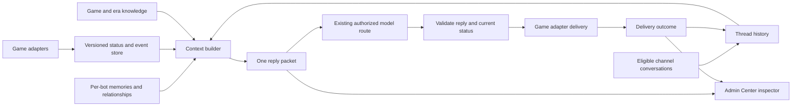

# Shared bot status and conversation context

Owner design request, 2026-11-04: context is the main chat problem; give each
reply and bot maximum useful context, and make DIT the shared status source
across games. This is a proposed design. No new runtime, model call, producer
contract, deployment or live access has been enabled by this document.

Implementation checkpoint: the [first offline hub candidate](../handoffs/context-slice-20261104/README.md)
separates history from trigger facts and captures the exact wording prompt.
Four synthetic FFXI/SWTOR reply/rewrite captures retain all 12 supplied turns.
The candidate remains default-off and unapplied to the shared hub; this is not
evidence of improved live conversation. A separate [status read projection
candidate](../handoffs/status-slice-20261104/README.md) defines the common scoped,
freshness-aware read view. The [offline integration candidate](../handoffs/context-status-integration-20261104/README.md)
now binds that view into companion, heard and intent prompts through an injected
source, with a status recheck after generation. No production source or live
Admin feed is wired. Real producer mappings, native delivery and memory remain
next; the integration fixtures do not establish live conversation quality.

The next isolated [producer mapping candidate](NATIVE-STATUS-PRODUCER-MAPPING.md)
reads the existing FFXI ordered store with authenticated caller scope. Its v1
producer lacks explicit presence and the native identity registry is not
configured, so known body facts remain withheld; SWTOR's native feed remains a
producer dependency. The [native-browser checklist](CONTEXT-NATIVE-BROWSER-CHECKLIST.md)
and dedicated panel fixture are prepared. Native execution remains NOT RUN.
The [context limit audit](CONVERSATION-CONTEXT-LIMITS.md) separates producer,
transport and prompt limits so a full captured-input count is not mistaken for
a complete original conversation.

The [context/voice compatibility follow-up](../handoffs/context-voice-compat-20261104/README.md)
rebases the source candidate onto hub `3dd21dc7`, preserving newer channel and
shout voice rules. It fixes a reproduced interaction in which status binding
dropped shout protection; all 83 focused checks pass in the isolated checkout.
The updated combined patch remains local and unapplied to the shared hub.

Current readiness, after the local inspector consistency fix (`b7e3688`):

| Part | What is ready locally | What is still unverified or missing |
| --- | --- | --- |
| Conversation context | Structured history reaches the candidate prompt separately from behavior facts; repeated turns remain ordered | History already discarded upstream is not recovered; real model understanding is untested |
| Shared status | Scoped source adapter, expiry/revision checks, and explicit unknown values | Verified FFXI native identity/presence and an equivalent SWTOR producer; live status is not enabled |
| Inspector | Exact captured context/status agreement, empty and unavailable packets, stale-clear/recovery; 25 focused Python checks plus simulated-DOM passed | Native browser rendering remains NOT RUN; this is a synthetic capture inspector, not live monitoring |
| Conversation provenance | [Scoped producer proposal](CONVERSATION-TURN-PROVENANCE-PROPOSAL.md) separates drafts, publication, confirmed speech and ambiguous outcomes | Stable native turn identities and delivery evidence are not an agreed/implemented producer contract |
| Delivery analysis | [Read-only offline correlator and optional inspector](DELIVERY-EVIDENCE-CORRELATION.md) join publication records; the [candidate-output harness](SYNTHETIC-DELIVERY-HARNESS.md) checks synthetic receipt transport and rejects cross-run replay | Actual delivery remains Unknown; the API has no native verifier. No real-log collection or receipt-driven history update is connected |
| Owner overview | [Video and earlier preview deliveries](CROSS-GAME-CONTEXT-VIDEO-DELIVERY.md) are recorded on Alienware | Copy/hash receipts do not establish playback, browser validation or live game behavior |

The live chat issue remains unresolved. All runtime changes are isolated
candidates with default-off flags. The owning hub/game integrators retain the
native evidence and rollout steps; this progress does not release those holds.

## What a reply should know

Every game publishes its authoritative observations into DIT. DIT maintains a
versioned status view and builds one scoped context packet for each selected
speaker. The Admin Center inspects that same packet and the status versions it
used. Native game systems remain responsible for validating and executing actions.

The desired result is a continuing conversation: remember the question, who
answered, corrections, promises and unanswered follow-ups. Location and activity
help answer relevant questions; they are not mandatory content in every reply.
Bot-to-bot replies use the same context builder. Each selected speaker has its
own viewpoint. There is no all-bot response fan-out or self-sustaining chat loop.

## Why the current shape needs to change

Inspected hub source: `dit-ffxi-ls-replies-20261101` at
`f480969e13575b5e7294611c16ce4aaa8cc97713`. These are source findings, not a
verification of the live release or the cause of the owner's screenshot.

| Current source | Constraint and consequence |
| --- | --- |
| `DialogueWordingModels.cs`, `DialogueWordingRequest` / `DialogueContextFact` | Trigger facts: 16; each value: 256 characters. Conversation competes with instructions for these slots. |
| `ConversationService.Companion.cs`, `CompanionRequest` | History is appended after behavior and grounding instructions. The existing recent-context flag chooses the newest lines that fit, but cannot create room. |
| `FfxiRecentContextTests.cs` | Explicit boundary assertions retain one history turn, or zero during a rewrite. These tests were inspected, not rerun for this design. |
| `Arbitration/GroupChat.cs`, `AnswerAsync` | Room and pair histories are concatenated, deduplicated by text and reduced to 12 lines. Event identity and chronology need an explicit representation. |
| `DialogueWordingPromptText.cs` | A further 24,576-character serialized prompt limit applies. Increasing one upstream count alone cannot deliver a larger effective context. |

The newer bridge source is separately maintained under
`dit-ffxi-bridge-integration-20261029/tools/ffxi/ai_only`. Its existing untracked
r12 cleanup candidate was inspected and left intact. The DIT lead remains the
sole live integrator. Its recorded standing policy is AI-generated speech or
silence; that policy does not prove the origin of any particular screenshot line.

## One status system, explicit ownership

Use a canonical identity `(game, realm, instance, nativeActorId, sessionEpoch)`.
A persona is linked to this identity by the verified adapter mapping. Display
names alone never identify a body. A persistent persona may span games, while
its current location, inventory, party and progress remain game/realm scoped.

Adapters publish snapshots and ordered deltas with source, sequence, observation
time, receipt time and validity. A restart creates a new epoch. Duplicate events
are idempotent; old epochs and late deltas cannot overwrite newer state. Missing
sequence ranges require a fresh snapshot before dependent fields are trusted.
Status fields update atomically within each producer revision. A reply captures
the exact revisions it read; it never implies that independently sampled games
or producers supplied a simultaneous global snapshot.

| Status domain | Example data | Rule |
| --- | --- | --- |
| Current body | Presence, zone, activity, combat, party, target | Native observation with field-specific expiry; a heartbeat cannot refresh old field values. |
| Durable progress | Level, job, missions, inventory, unlocks | Confirmed native revision; reconnect or missing changes require reconciliation. |
| Intent | Current goal, next step, outstanding request | DIT plan, explicitly separate from accepted or completed action. |
| Persona | Voice, interests, preferences | Versioned persistent configuration; interests are not evidence of current activity. |
| Conversation | Visible turns, questions, corrections, commitments | Speaker attribution and delivery state; quoted chat is a claim. |
| Memory | Prior encounters, preferences, shared experiences | Source references, visibility, timestamp and scope; summaries cannot create game facts. |

Fields carry `known`, `stale`, `unknown` or `conflicted` state, provenance and
age. Define validity per game/field using actual feed cadence and acceptable
staleness. No single guessed timeout for every field. Source conflicts stay
visible; arrival time alone does not resolve incompatible producer claims.
Disconnect explicitly invalidates presence. Unavailable data never means idle,
offline, zero inventory or completed work.

All bot planners, conversational callers and the inspector use this shared
status projection. Time-critical combat and movement keep their native local
loops and validations; a slow hub or model cannot freeze gameplay.

## A context packet with separate sections

Replace history encoded as generic trigger facts with a versioned, structured
conversation section throughout request validation, serialization and provider
adapters. Retain explicit bounds and backward compatibility. Audit each stage
for hidden truncation, including the final provider payload.

1. **Identity and current turn:** verified speaker and listener, channel/audience,
   turn ID, thread ID, reply target and why this bot was selected.
2. **Current status:** the answering bot's fresh state, plus other participants'
   permitted observations. Include unknowns needed to avoid unsupported claims.
3. **Active conversation:** chronological, speaker-labelled turns, the latest
   message, corrections and unanswered questions. Prefer the complete active
   exchange; never discard it merely because behavior rules consumed fact slots.
4. **Thread state:** topic, unresolved references, who's awaiting whose answer,
   explicit commitments and their actual outcomes. Each extracted item cites
   source turn IDs and can be corrected or retracted.
5. **Personal memory:** relevant prior interactions and relationship facts for
   this bot and these participants, with scope and provenance.
6. **Game knowledge:** relevant rules, era, zone, quest and item information,
   distinguished from personal experience and current observations.
7. **Behavior and delivery limits:** persona, channel conventions, allowed
   recipients, reply length, grounding and AI-or-silence policy.
8. **Context receipt:** source revisions, freshness, included/omitted counts,
   summary coverage, token use, model route and packet digest.

The full internal status store can describe many actors; a bot receives only
what it is allowed to know. Party/tell visibility, room membership at the time
of each turn and instance boundaries apply before retrieval or summarization.
Private conversations never enter public-thread memory. Cross-game sharing
requires an explicit persona association and appropriate visibility; it must
not transfer one game's inventory, location or quests into another game.

Conversation text and summaries remain untrusted data. They cannot grant tool
access, change policy, change state authority or expand an audience. A bot saying
"I'm crafting" does not update its activity to crafting. Plans and generated
speech become completed actions only after a native outcome confirms them.

## Maximum useful context within a measured budget

Choose the largest relevant packet that fits the existing authorized model,
latency and spending policy. Context capacity is a property of the effective
route and serializer, not an assumed capability based on a model name.

`input budget = min(model window - output reserve - wrapper margin,
configured input limit, authorized cost limit, measured latency limit)`

Mandatory identity, current input, required truth constraints and correction
instructions are retained first. Reserve independent capacity for the active
conversation. Then add relevant status, thread state and memory; spend remaining
space on useful older turns and knowledge. Unused capacity can move between
sections. Repeated policy prose and duplicated facts should not consume the
conversation allocation.

When the exchange exceeds the budget, keep the newest contiguous turns plus
referenced earlier turns, explicit corrections and pending questions. Compress
older context into a source-linked summary; retain the originals in the
authorized store for retrieval. Track omissions and summary coverage. Do not
silently truncate a current message or split a turn mid-sentence. If mandatory
content cannot fit, report the context failure and produce no invented reply.

Use a provider-compatible token count for the actual serialized request. If
only an estimate is available, label it and apply a conservative bound. No
automatic upgrade to a paid route, higher spend or external summarization is
implied. Model summaries use existing authorized budgets; deterministic thread
extraction and raw history remain available when summarization is unavailable.

Cache stable persona/knowledge sections and incremental status projections.
Do not call a model for every status tick or every bot that overhears a line.
Select the speaker first, then build its context. Keep output short enough for
the game's chat channel while allowing a much richer input.

## Ordering and delivery

Identify turns by event ID, source sequence and epoch, not text equality. A
legitimate repeated question is a new turn; transport echoes are duplicates.
Preserve room chronology and attach pair-specific memories separately rather
than appending old pair turns after newer room messages.

Record the stages `observed -> selected -> context built -> generated ->
validated -> queued -> delivered/failed/unknown`. A generated or queued line
must not enter history as something everyone heard. Where the adapter has no
native delivery receipt, leave delivery unknown; it is a producer dependency.
Late delivery acknowledgements reconcile by turn identity without duplicate
speech. Pending turns can be shown as pending to prevent overlapping responses.

Before delivery, recheck identity, membership, important status revisions and
whether the answered turn is still relevant. A moved, disconnected or retargeted
bot must not publish an obsolete claim. Cancel or reconsider under the same
budget and idempotency rules; do not create an unlimited retry loop. Retain
native action validation and all player-protection/release gates.

## What the Admin Center should show

Select a bot to inspect current status with age/source, its active thread,
relevant memories and pending commitments. Select a reply to inspect the exact
context receipt: what it knew, what was missing or omitted, which status versions
were used, and whether generated speech was delivered. Compare two replies to
find the first point where the topic, identity or state changed.

This inspector should consume an authorized projection of the same hub packet,
not reconstruct a separate answer from dashboard caches. Text access and export
remain within existing permissions. Digests/counts do not prove that the model
understood the content. Live Admin access still requires the recorded reader
access or snapshot decision; this design does not resolve that hold.

## Small implementation slices and acceptance

Start with an offline vertical slice for FFXI and a second game (SWTOR, following
the Admin Center brief), using synthetic data and the same core contracts.
Keep game-specific fields in typed extensions. No new ambient-chat activation
or cross-game information sharing follows automatically.

| Slice | Focused acceptance evidence |
| --- | --- |
| Structured context | A multi-speaker exchange survives all request/serialization stages, including a rewrite, without losing the current question or preceding answer. Capture the exact fake-provider request. |
| Status projection | Two bots read consistent revisions; wrong actor/realm, old epochs, duplicate/out-of-order deltas, disconnects and stale fields produce the specified explicit states. |
| Thread and memory | Interruptions, delayed answers, topic changes and corrections retain their target. Repeated bot claims never become confirmed activity. Private turns cannot leak across rooms/games. |
| Budget and delivery | Saturation reports omissions; required sections survive; missing receipts remain unknown; late/duplicate replies cannot create duplicate delivery. |
| Inspector | The synthetic displayed packet matches the captured request and its receipt; counts, missing fields and delivery stage agree. |
| Owner playtest | Once the existing integrator can release within the actual holds, the owner tries a short natural exchange and reports quality. Offline structural passes alone cannot establish natural conversation. |

The screenshot supplies the symptom: repeated topic agreement followed by zone
updates. A synthetic acceptance scenario should exercise that pattern without
mandating a canned "good" line. Check that the selected bot sees the exchange,
understands who said what, uses its own status, and can contribute or stay quiet.
Actual model behavior and visible speech remain unverified until separately
authorized checks and owner playtest establish them.

The first build should address structured history and show its context receipt.
Then add the shared status and memory slices. Keep changes small and use focused
checks; a broad new test gate or coordinator sign-off is not required.
